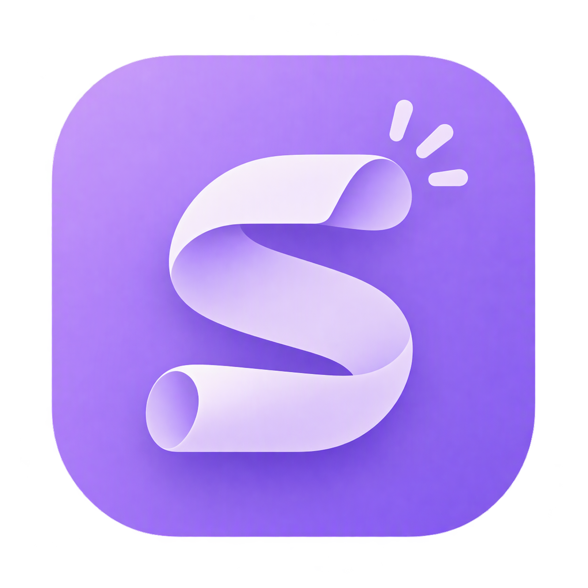
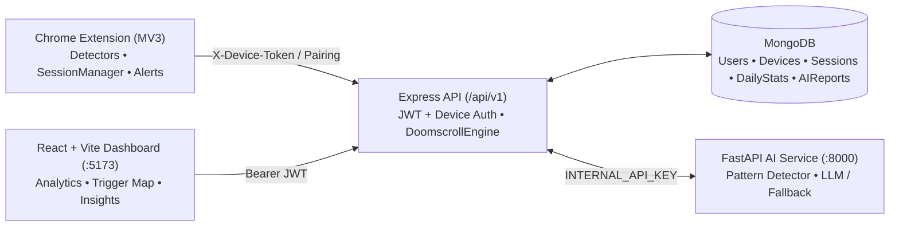

<div align="center">
  
  <h1>ScrollSense</h1>
  <p><strong>Understand your scrolling. Reclaim your time.</strong></p>
  <p>
    An AI-powered, privacy-first digital wellbeing platform for monitoring, understanding, and mindfully managing desktop short-video consumption across <strong>Instagram Reels</strong> and <strong>YouTube Shorts</strong>.
  </p>
</div>

[](https://github.com/PratikWani8/ScrollSense/releases/latest)


---

## Overview

ScrollSense combines a **Manifest V3 Chrome extension**, a **Node.js + Express + MongoDB backend**, a **React + Vite analytics dashboard**, and a **Python FastAPI AI microservice** to turn passive short-video scrolling into transparent, actionable digital wellbeing insights without collecting browsing history, video URLs, or personal media content.

### Core Capabilities

- **Local-First Active Tracking (Chrome Extension MV3)**
  - Accurately measures active feed dwell time on desktop Instagram Reels and YouTube Shorts using focus/visibility-aware timestamp slices (paused tabs and background windows never accumulate time).
  - Heuristic video view estimation based on viewport-centered dwell thresholds ($\ge 2.0\text{s}$).
  - Service Worker suspension recovery snapshots and offline sync queuing (`chrome.storage.local`).
  - Translucent glassmorphism popup UI with hidden scrollbars, live stopwatch, habit risk meter, and device pairing.
- **Intent-Aware Scrolling & Automatic Alerts**
  - Commit a session intention (e.g., *Learning*, *Entertainment*, *Finding Something Specific*, *Taking a Short Break*) and time budget before or during a session.
  - **Automatic Desktop Notifications** (`chrome.notifications`) trigger automatically when the active duration reaches your planned limit no need to keep the popup or dashboard open.
  - **Isolated In-Page Floating Alerts** injected cleanly via Shadow DOM (`InPageAlert`) over Reels and Shorts feeds with *Take a Break*, *Continue for 5 min*, and *Dismiss* actions.
  - **Developer Testing Mode (10s)** toggle in the popup unlocks 10-second thresholds and extensions for rapid end-to-end verification.
- **Deterministic Doomscroll Detection & Behavioral Analytics**
  - Explainable `DoomscrollDetectionEngine` scores risk (`0–100`) from continuous session length, daily goal ratio, repeated feed returns, navigation cadence, quiet hours (`23:00–07:00` default), and prolonged session count.
  - **Personal Trigger Map** heatmap correlates logged browsing impulses (*Boredom*, *Break*, *Procrastination*, *Stress*, *Habit*) across days and dayparts.
  - **Time Reclaimed Score** compares active usage against daily limits and intentional adherence streaks.
- **AI Behavioral Insights Microservice**
  - Dedicated FastAPI service computes deterministic trend statistics and synthesizes structured, non-diagnostic habit reports.
  - Supports **Gemini**, **OpenAI**, or a zero-dependency deterministic **local fallback provider** (`LLM_PROVIDER=fallback`).
- **Zero-Knowledge Privacy & GDPR Controls**
  - Strictly excludes raw URLs, video titles, creator handles, thumbnails, comments, and watch history.
  - Full data export (`GET /api/v1/privacy/export`), retention controls, selective data wipe, and account deletion.

---

## Architecture



---

## Monorepo Structure

```text
ScrollSense/
├── package.json                 # npm workspaces & monorepo dev/build/test scripts
├── docker-compose.yml           # Full-stack containers (MongoDB, AI, Backend, Frontend)
├── start-all.ps1                # Windows helper to launch AI, Backend, and Frontend dev servers
├── .env.example                 # Root Docker/deployment environment template
├── extension/                   # Chrome Extension Manifest V3 (TypeScript + Vite)
│   ├── manifest.json            # Minimal MV3 permissions & web-accessible logo icon
│   ├── src/
│   │   ├── background/          # Service worker, active ticker, alerts, StorageManager, SyncManager
│   │   ├── content/             # Instagram Reels & YouTube Shorts detectors + Shadow DOM InPageAlert
│   │   ├── tracking/            # SessionManager state machine, DoomscrollEngine, VideoEstimator
│   │   ├── popup/               # Glassmorphism popup UI, settings switches, intent & trigger controls
│   │   ├── shared/              # Shared TypeScript contracts, constants, and typed IPC messages
│   │   └── icons/               # Extension PNG icons (16px, 48px, 128px)
│   ├── scripts/
│   │   ├── build.mjs            # Builds background, content scripts, popup UI, and copies assets
│   │   └── package.mjs          # Packages extension/dist into Chrome Web Store .zip
│   └── tests/                   # 12 Vitest suites (52 tests)
├── backend/                     # Node.js + Express + TypeScript + Mongoose REST API
│   ├── Dockerfile
│   ├── src/
│   │   ├── config/              # Zod env validation, MongoDB connection, graceful shutdown
│   │   ├── middleware/          # JWT auth, hashed X-Device-Token auth, rate limiters, error handler
│   │   ├── models/              # User, Device, TrackingSession, TrackingEvent, DailyStats, AIReport, etc.
│   │   ├── routes/              # /api/v1 endpoints (auth, devices, sessions, events, analytics, etc.)
│   │   └── services/            # DoomscrollDetectionEngine, aggregation, retention cleanup
│   └── tests/                   # 8 Vitest/Supertest suites (41 tests)
├── frontend/                    # React 18 + Vite + Tailwind + Framer Motion + Recharts
│   ├── Dockerfile
│   ├── nginx.conf
│   ├── public/
│   │   └── scrollsense_logo.png # Brand logo asset
│   ├── src/
│   │   ├── api/                 # Typed REST client & contracts
│   │   ├── components/          # Navbar, Sidebar, MetricCard, DoomscrollMeter, TriggerMap, TimeReclaimed
│   │   ├── context/             # AuthContext
│   │   └── pages/               # Landing, Login, Register, Privacy, Overview, Sessions, Analytics, Insights, Goals, Devices, Settings
│   └── tests/                   # 2 Vitest + Testing Library suites (16 tests)
├── ai-service/                  # Python FastAPI Behavioral Analytics & LLM Service
│   ├── Dockerfile
│   ├── requirements.txt
│   ├── app/
│   │   ├── main.py              # FastAPI app, CORS, health & insights routers
│   │   ├── config.py            # Pydantic settings (INTERNAL_API_KEY, LLM provider config)
│   │   ├── schemas/             # Request & response Pydantic schemas
│   │   └── services/            # Deterministic analytics, pattern detector, prompt builder, providers
│   └── tests/                   # 4 pytest suites (10 tests)
└── docs/
    ├── PRIVACY_POLICY.md        # Zero-knowledge privacy policy
    ├── CHROME_STORE_LISTING.md  # Chrome Web Store listing & permission justifications
    └── DEPLOYMENT_GUIDE.md      # Production deployment, Docker, MongoDB Atlas, backup notes
```

---

<<<<<<< HEAD
## Getting Started
=======

## 2. Testing & Verification

The monorepo contains **98 automated tests across 24 test suites**, all passing:

```bash
# Run all tests across Extension, Backend, Frontend, and AI Service (98 tests)
npm test

# Run individual test suites
npm run test:extension:run   # 44 tests (detectors, estimation, state machine, sync manager)
npm run test:backend         # 31 tests (auth, pairing, sync, doomscroll engine, retention, insights)
npm run test:frontend        # 13 tests (MetricCard, DoomscrollMeter, BreakdownModal, PublicPrivacyPage, etc.)
npm run test:ai              # 10 tests (health, analytics, pattern detector, internal auth, generator)

# Build all packages
npm run build

# Package Chrome Extension into store-ready distribution .zip
npm run package:extension
# Generates extension/dist-zip/scrollsense-extension-v1.0.0.zip
```

---

## 3. How to Run Locally
>>>>>>> a2c63252232694df1f02abef67ff31e0dc117263

### Prerequisites

- **Node.js** `>= 18` and `npm`
- **Python** `>= 3.10` and `pip`
- **MongoDB** running locally on `mongodb://localhost:27017` (or use Docker Compose)
- **Google Chrome** (Desktop) for loading the unpacked extension

### 1. Install Dependencies

```bash
# Install Node.js workspace dependencies (extension, backend, frontend)
npm install

# Install Python dependencies for the AI microservice
cd ai-service
pip install -r requirements.txt
cd ..
```

### 2. Configure Environment Variables

Copy the example templates and adjust secrets before running:

- **Backend (`backend/.env`):**
  ```env
  PORT=5000
  NODE_ENV=development
  API_PREFIX=/api/v1
  MONGODB_URI=mongodb://localhost:27017/scrollsense
  JWT_SECRET=super_secret_scrollsense_jwt_key_change_in_production_min_32_chars
  JWT_EXPIRES_IN=7d
  CORS_ORIGIN=http://localhost:5173,http://localhost:3000
  DEVICE_TOKEN_SALT=scrollsense_device_token_secret_salt_2026
  AI_SERVICE_URL=http://localhost:8000
  AI_SERVICE_KEY=scrollsense_internal_ai_secret_key
  ```
- **AI Microservice (`ai-service/.env`):**
  ```env
  PORT=8000
  HOST=0.0.0.0
  LLM_PROVIDER=fallback            # "fallback", "gemini", or "openai"
  GEMINI_API_KEY=
  OPENAI_API_KEY=
  LLM_MODEL_NAME=gemini-1.5-flash
  INTERNAL_API_KEY=scrollsense_internal_ai_secret_key
  TIMEOUT_SECONDS=10.0
  MAX_RETRIES=2
  CACHE_TTL_SECONDS=3600
  ALLOWED_ORIGINS=http://localhost:5000,http://localhost:5173
  ```
- **Frontend (`frontend/.env`):**
  ```env
  VITE_API_URL=http://localhost:5000/api/v1
  ```

> **Note:** Ensure `AI_SERVICE_KEY` in `backend/.env` matches `INTERNAL_API_KEY` in `ai-service/.env`.

### 3. Run Locally

Run the three backend/frontend services in separate terminals (or launch all three on Windows with `.\start-all.ps1`):

```bash
# Terminal 1: Backend API (http://localhost:5000/api/v1)
npm run dev:backend

# Terminal 2: FastAPI AI Microservice (http://localhost:8000)
npm run dev:ai

# Terminal 3: React Frontend (http://localhost:5173)
npm run dev:frontend
```

#### Alternative: Run Everything via Docker Compose

Copy `.env.example` to `.env`, configure secrets, and start MongoDB + AI Service + Backend + Nginx Frontend:

```bash
docker compose up --build -d
```

- Frontend SPA: `http://localhost:3000`
- Backend API: `http://localhost:5000/api/v1`
- AI Service: `http://localhost:8000/health`

### 4. Build & Load the Chrome Extension

```bash
npm run build:extension
```

1. Open Chrome and navigate to `chrome://extensions`.
2. Enable **Developer mode** (top-right).
3. Click **Load unpacked** and select `ScrollSense/extension/dist`.
4. Open the ScrollSense extension popup, create an account on the dashboard, and pair your device via **Connected Devices** (`/devices`) using the generated pairing code.

---

<<<<<<< HEAD
## API Overview
=======
## 4. Verified Behaviors & Known Boundaries
>>>>>>> a2c63252232694df1f02abef67ff31e0dc117263

The Express backend exposes versioned endpoints under `/api/v1`:

| Domain | Endpoints | Auth |
|---|---|---|
| **Health** | `GET /health`, `GET /api/v1/health` | Public |
| **Auth** | `POST /auth/register`, `POST /auth/login`, `GET /auth/me`, `POST /auth/logout` | Public / JWT |
| **Devices** | `POST /devices/pair/request`, `GET /devices/pair/status/:code`, `POST /devices/pair/approve`, `GET /devices`, `DELETE /devices/:deviceId` | Public / JWT |
| **Sessions & Intentions** | `POST /sessions/sync`, `GET /sessions`, `GET /sessions/:sessionId`, `GET /sessions/intentions/current`, `GET /sessions/intentions/adherence`, `POST /sessions/:sessionId/intention`, `POST /sessions/:sessionId/context` | JWT / Device Token |
| **Events** | `POST /events/batch` | Device Token |
| **Analytics** | `GET /analytics/overview`, `GET /analytics/trends`, `GET /analytics/platforms`, `GET /analytics/hourly`, `GET /analytics/weekly-report`, `GET /analytics/trigger-map`, `POST /analytics/trigger-map/context`, `GET /analytics/time-reclaimed` | JWT / Device |
| **Goals & Doomscroll** | `GET /goals`, `PUT /goals`, `GET /doomscroll/breakdown`, `GET /doomscroll/events`, `POST /doomscroll/events/:id/status`, `GET /doomscroll/summary`, `PUT /doomscroll/settings` | JWT |
| **AI Insights** | `POST /insights/generate`, `GET /insights`, `GET /insights/latest`, `GET /insights/:reportId` | JWT |
| **Privacy** | `GET /privacy/export`, `DELETE /privacy/data`, `DELETE /privacy/account`, `GET /privacy/retention`, `PUT /privacy/retention`, `POST /privacy/cleanup` | JWT |

---

## Testing, Building & Packaging

### Automated Test Suites (119 Tests across 26 Files)

```bash
# Run all test suites sequentially
npm test

# Or run each workspace independently:
npm run test:extension:run   # 12 files, 52 tests (detectors, SessionManager, alerts, sync, SW recovery)
npm run test:backend         # 8 files, 41 tests (auth, pairing, sync, doomscroll, analytics, insights, privacy)
npm run test:frontend        # 2 files, 16 tests (UI components, pages, privacy, trigger map, time reclaimed)
npm run test:ai              # 4 files, 10 tests (FastAPI health, analytics, pattern detector, LLM generator)
```

### Production Builds & Chrome Web Store Packaging

```bash
# Build extension, backend (tsc), and frontend (tsc + Vite)
npm run build

# Package Chrome Extension into extension/dist-zip/scrollsense-extension-v1.0.0.zip
npm run package:extension
```

---

## Privacy & Scope Boundaries

- **Zero-Knowledge Telemetry:** ScrollSense records only anonymized session timings, estimated view counts, navigation frequencies, trigger categories, and intention adherence flags. It never inspects or transmits video URLs, video titles, creator identities, thumbnails, or general browsing history.
- **Non-Diagnostic Tooling:** Habit risk scores, reclaimed-time metrics, and AI insights are reflective wellbeing indicators, not medical or psychological diagnoses.
- **Platform Scope:** Active extension tracking operates on desktop Chrome for `instagram.com` (Reels) and `youtube.com` (Shorts).

### Additional Documentation
- [Privacy Policy](docs/PRIVACY_POLICY.md)
- [Chrome Web Store Listing](docs/CHROME_STORE_LISTING.md)
- [Deployment Guide](docs/DEPLOYMENT_GUIDE.md)

---
